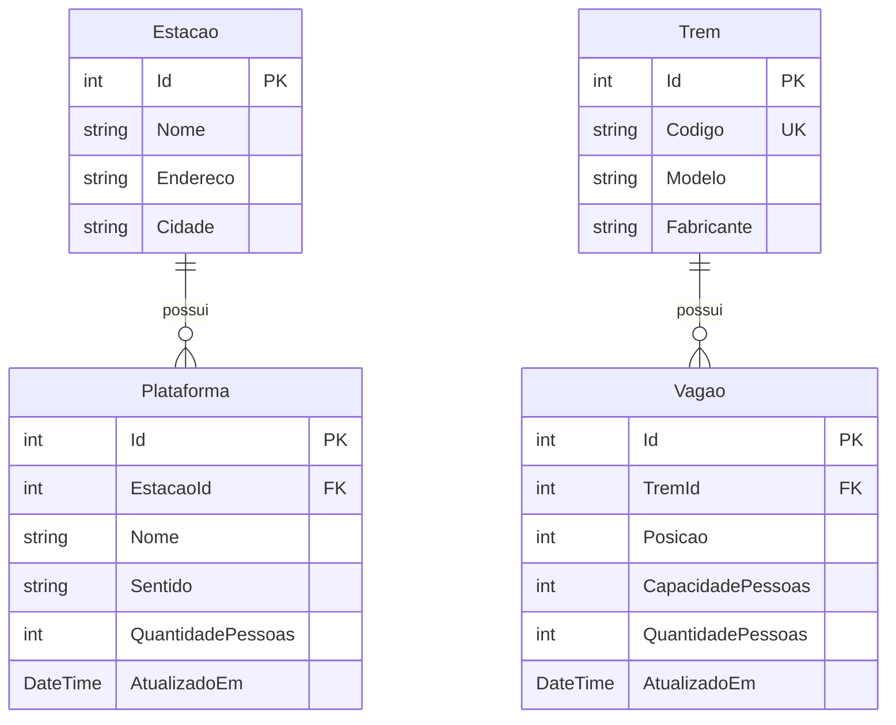

# Projeto FLUXO — Global Solution 2026/2 .NET

## Sobre o projeto

A lotação no transporte público ferroviário dificulta o embarque e pode concentrar passageiros em alguns vagões enquanto outros ainda possuem espaço.

O FLUXO propõe usar contagens de pessoas para informar a ocupação dos vagões e ajudar a companhia a acompanhar a demanda nas plataformas. O passageiro poderá identificar onde há mais espaço antes de embarcar. A operadora poderá comparar quantas pessoas estão esperando com a capacidade disponível de um trem e avaliar a necessidade de reforço do serviço.

Este projeto é a API da solução CitizenTech desenvolvida para a Global Solution 2026/2 da FIAP, no eixo Cidades, com foco em mobilidade. O protótipo usa dados simulados, informados pelo Postman. A integração com câmeras e os visores físicos são possibilidades de evolução da solução.

## Integrantes — 2TDSPR

| **Nome** | **RM** |
| --- | --- |
| Luana Alves de Oliveira | 566621 |
| Isabely Marques da Silva | 566663 |
| Mateus Ribeiro Azevedo | 566630 |
| Paulo Gustavo Moraes de Sousa | 568580 |

## O que foi desenvolvido

Foi desenvolvida uma API REST em **C# com ASP.NET Core 8**, utilizando controllers, **Entity Framework Core** e persistência no **Oracle da FIAP**. As alterações do banco são versionadas por migrations.

## Modelo de dados

O modelo possui quatro entidades e dois relacionamentos 1:N. Uma estação possui várias plataformas e um trem possui vários vagões.

| Entidade | Principais atributos |
| --- | --- |
| Estação | Identificador, nome, endereço e cidade. |
| Plataforma | Identificador, estação, nome, sentido, quantidade atual de pessoas e horário da atualização. |
| Trem | Identificador, código, modelo e fabricante. |
| Vagão | Identificador, trem, posição, capacidade, quantidade atual de pessoas e horário da atualização. |



No diagrama, `PK` indica a chave primária, `FK` a chave estrangeira e `UK` um campo único. Cada plataforma pertence a exatamente uma estação, e cada vagão pertence a exatamente um trem. Uma estação pode ter zero ou várias plataformas; um trem pode ter zero ou vários vagões.

`Endereco`, `Cidade`, `Modelo` e `Fabricante` são opcionais. `QuantidadePessoas` e `AtualizadoEm` também podem ser nulos na plataforma e no vagão. Além do código único do trem, a combinação de `TremId` e `Posicao` deve ser única para cada vagão.

Cada atualização substitui a ocupação anterior. O protótipo guarda a contagem mais recente diretamente na plataforma e no vagão.

## Arquitetura e organização

```text
├── Controllers/
│   ├── EstacaoController.cs
│   ├── PlataformaController.cs
│   ├── TremController.cs
│   └── VagaoController.cs
├── Data/
│   └── AppDbContext.cs
├── Models/
│   ├── Estacao.cs
│   ├── Plataforma.cs
│   ├── Trem.cs
│   └── Vagao.cs
├── DTOs/
│   ├── EstacaoInput.cs
│   ├── EstacaoResponse.cs
│   ├── PlataformaInput.cs
│   ├── AvaliacaoCapacidadeResponse.cs
│   ├── TremInput.cs
│   ├── TremResponse.cs
│   ├── VagaoInput.cs
│   ├── VagaoResponse.cs
│   └── LotacaoResponse.cs
├── Migrations/
├── Program.cs
├── appsettings.json
└── Fluxo.postman_collection.json
```

- **Models** representa as entidades persistidas no banco.
- **DTOs** organiza os dados de entrada e resposta da API, incluindo as validações dos campos recebidos. `LotacaoResponse` reúne a lotação e sua classificação.
- **Controllers** recebe as requisições, valida os dados e executa os cadastros e as consultas.
- **Data** configura o contexto e os relacionamentos usados pelo Entity Framework Core.
- **Migrations** registra as alterações na estrutura do Oracle.
- **Program.cs** configura os controllers, a conexão com o banco e a documentação interativa da API.
- **Coleção Postman** fornece exemplos para testar os CRUDs e apresentar o protótipo.

## Funcionalidades

- Cadastrar, listar, consultar por ID, alterar e excluir estações, plataformas, trens e vagões.
- Atualizar a quantidade atual de pessoas na plataforma e em cada vagão.
- Consultar a faixa de lotação de um vagão ou de todos os vagões de um trem.
- Comparar a demanda da plataforma com o espaço disponível no trem escolhido.
- Retornar uma indicação para avaliar reforço do serviço quando a capacidade for insuficiente.

## Validações e regras de negócio

- Nomes, sentido e código são obrigatórios. IDs de vínculo, posição e capacidade devem ser positivos; a estação e o trem vinculados precisam existir.
- O código do trem e a posição de cada vagão no mesmo trem são únicos.
- A contagem aceita zero ou mais pessoas, inclusive superlotação. `null` limpa a contagem e o horário. No PUT, envie o cadastro completo.
- Lotação: abaixo de 50% verde; de 50% a menos de 80% amarelo; a partir de 80% vermelho. Leituras ausentes ou com mais de cinco minutos ficam indisponíveis.
- A avaliação compara pessoas na plataforma com lugares livres no trem e exige leituras recentes. A decisão de reforçar o serviço cabe à operadora.

## Como executar

Tenha o **SDK do .NET 8**, acesso ao Oracle da FIAP e o Postman para seguir os exemplos.

1. Clone o repositório e entre na pasta do projeto.

```powershell
git clone https://github.com/pgmoraesdev/FLUXO_GS_2026_NET.git
cd FLUXO_GS_2026_NET
```

2. Se a ferramenta `dotnet ef` ainda estiver ausente, instale-a.

```powershell
dotnet tool install --global dotnet-ef --version 8.0.33
```

3. Configure a conexão usando os dados da sua conta Oracle. Substitua os valores do exemplo pelas informações fornecidas pela FIAP. O comando guarda a conexão em User Secrets na sua máquina.

```powershell
dotnet user-secrets set "ConnectionStrings:OracleConnection" "User Id=SEU_USUARIO;Password=SUA_SENHA;Data Source=HOST:PORTA/SERVICO"
```

4. Restaure os pacotes e confira a compilação.

```powershell
dotnet restore
dotnet build
```

5. Configure um schema de desenvolvimento vazio e aplique a migration inicial. O histórico foi consolidado em `InitialCreate`, que cria somente estação, plataforma, trem e vagão, incluindo os campos de cadastro e ocupação atuais.

Se o schema já recebeu as migrations antigas, ele precisa ser preparado antes: use outro schema vazio ou remova as tabelas deste projeto e seu histórico em `__EFMigrationsHistory`, perdendo os respectivos dados. A nova migration não faz a atualização do histórico anterior. Preserve tabelas de outros projetos que compartilhem o mesmo schema.

```powershell
dotnet ef database update
```

6. Inicie a API com o perfil HTTP.

```powershell
dotnet run --launch-profile http
```

A URL configurada nesse perfil é `http://localhost:5248`. A documentação interativa fica em `http://localhost:5248/scalar/v1` no ambiente de desenvolvimento.

No Visual Studio, abra `Fluxo_GS_2026_2TDSPR.csproj`, selecione o perfil `http` e execute com **Ctrl + F5**. A configuração da conexão e a aplicação das migrations também são necessárias nesse fluxo.

## Como testar

Importe `Fluxo.postman_collection.json`, ajuste a variável `baseUrl` se necessário e execute a coleção na ordem apresentada. Ela inclui os CRUDs, verificações de dados inválidos, sinalização de lotação e comparação de capacidade. A pasta de limpeza remove os registros criados durante a execução.

As quatro rotas de cadastro são `/api/Estacao`, `/api/Plataforma`, `/api/Trem` e `/api/Vagao`.

| Operação | Método e rota | Resposta esperada |
| --- | --- | --- |
| Listar | `GET /api/Entidade` | `200 OK` |
| Consultar | `GET /api/Entidade/{id}` | `200 OK` ou `404 Not Found` |
| Cadastrar | `POST /api/Entidade` | `201 Created` com o ID e o cabeçalho `Location` |
| Alterar | `PUT /api/Entidade/{id}` | `204 No Content` |
| Excluir | `DELETE /api/Entidade/{id}` | `204 No Content` |
| Informar dados inválidos | `POST` ou `PUT` | `400 Bad Request` com mensagem JSON |
| Informar ID inexistente | Operações que exigem um recurso existente | `404 Not Found` com mensagem JSON |
| Repetir código de trem ou posição no mesmo trem | `POST` ou `PUT` | `409 Conflict` |

Substitua `Entidade` pelo nome da rota desejada. As consultas específicas são as seguintes.

| Consulta | Rota |
| --- | --- |
| Lotação de um vagão | `GET /api/Vagao/{id}/lotacao` |
| Lotação do trem, por posição | `GET /api/Trem/{id}/lotacao` |
| Comparação entre plataforma e trem | `GET /api/Plataforma/{id}/avaliar-capacidade?tremId={idDoTrem}` |

## Persistência dos dados

Os cadastros e as contagens atuais são gravados no Oracle pelo Entity Framework Core. A migration `InitialCreate` representa a estrutura atual completa. Novas alterações no modelo devem gerar novas migrations; o snapshot deve permanecer versionado junto delas.

Para verificar a persistência, cadastre uma estação, copie seu ID e encerre a API. Inicie a API novamente com a mesma conexão e consulte `GET /api/Estacao/{id}`. O registro deverá continuar disponível. Faça essa verificação antes de executar a limpeza do Postman.

## Como o .NET se aplica à solução

O .NET implementa a API que recebe as contagens simuladas, mantém os cadastros no Oracle e disponibiliza informações de lotação e capacidade. Essas respostas podem alimentar os visores para os passageiros e uma interface de acompanhamento para a companhia. Na evolução do projeto, um módulo de visão computacional poderá fornecer as contagens que hoje são informadas manualmente.
